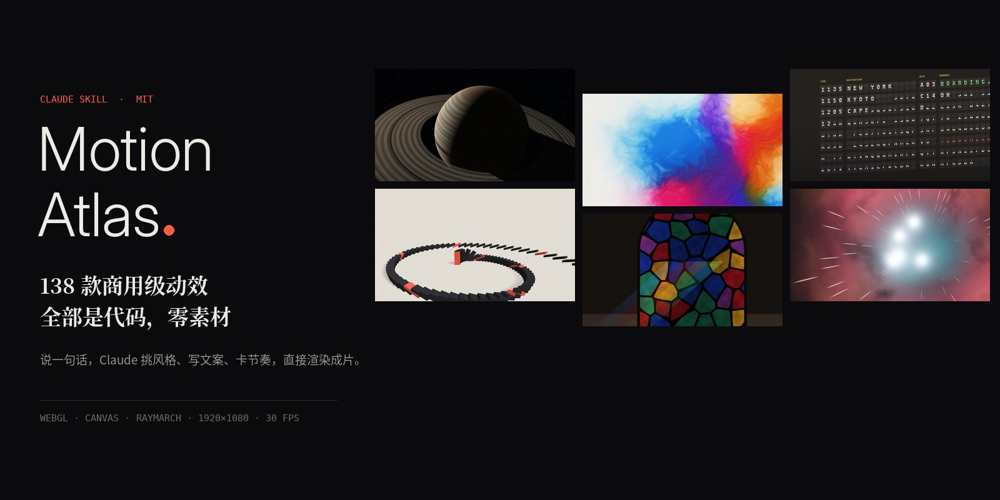
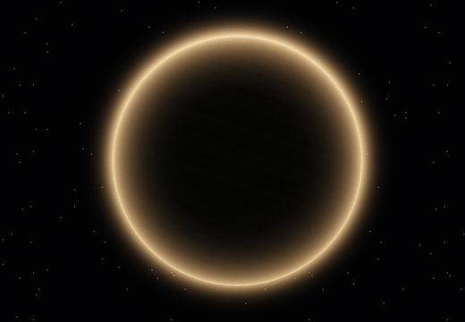
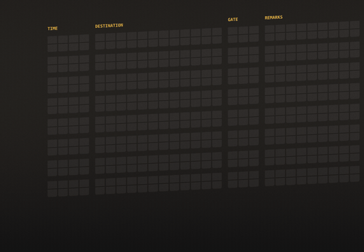
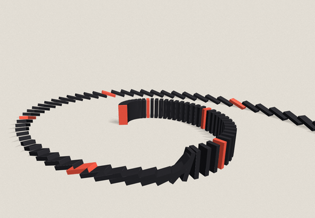
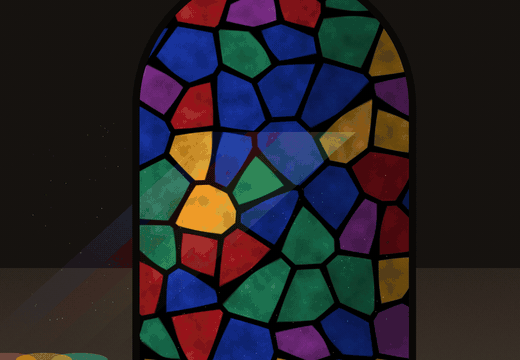

<p align="center"></p>

<h1 align="center">Motion Atlas · 动效图鉴</h1>

<p align="center"><b>138 种商用级动效，全部是代码，零素材。</b><br>一个 Claude Skill：说一句话，挑风格、写文案、卡节奏，直接渲染成片。</p>

<p align="center">
  <a href="https://USERNAME.github.io/motion-atlas/"><b>▶ 在线预览（实时运行）</b></a> ·
  <a href="STYLES.md">全部 138 款</a> ·
  <a href="SKILL.md">SKILL.md</a> ·
  <a href="#运行">快速开始</a>
</p>

<table>
<tr>
<td width="33%"><br><b>土星日出</b> · 光线追踪</td>
<td width="33%"><br><b>彩墨冲撞</b> · 域扭曲</td>
<td width="33%"><br><b>机场翻牌</b> · 错峰时序</td>
</tr>
<tr>
<td><br><b>多米诺</b> · 连锁节奏</td>
<td><br><b>彩绘玻璃</b> · 透光着色</td>
<td><br><b>孟菲斯</b> · 弹性入场</td>
</tr>
</table>


## 你能拿它做什么

- **看：** 用浏览器打开 `app/gallery.html`，按 ← / → 浏览全部 138 款动效，都是实时运行的。
- **拼一支视频：** 改 `app/scenes.js`，挑哪几款、什么顺序、每款几秒；再改 `app/meta.js` 里的文案；最后运行 `python3 tools/render.py`，就能出片。
- **拿走单个动效：** 每款都是独立的一小段代码，可以直接搬到你的网页、作品集或发布会里用。
- **配合 Claude 使用：** 把 `SKILL.md` 装成 Claude 的 skill。之后跟 Claude 说「用暗黑科技风挑 8 款，做一支 40 秒的产品开场」，它会直接调用这里的代码。

## 三种用法

**1. 拼一整支视频**：在 `app/scenes.js` 的 PICK 里列出要用的风格和顺序，运行 `python3 tools/render.py`，出来的是带片头快剪、文字栏、结尾图片墙和配乐的完整成片。

**2. 只拿一款，插进你自己的视频**：导出一段干净的素材（没有文字栏、没有边框、没有配乐），再拖进剪映、Premiere、Final Cut 里和你的画面拼在一起。

```bash
python3 tools/clip.py COLORINK                 # 6 秒横版 1920×1080
python3 tools/clip.py SATURNX --dur 4          # 把整段动画压进 4 秒
python3 tools/clip.py SPLITFLAP --vertical     # 竖版 1080×1920，抖音 / 小红书用
python3 tools/clip.py GLASS --png              # 额外保留逐帧 PNG，方便调色
```

**3. 放进网页里实时播放**：引入 `app/` 里的脚本，再调用 `renderST(编号, 时间)` 每帧绘制。`docs/index.html` 就是一个现成的例子。

用 Claude 的话，以上三种都只需要说一句话，比如：

- 「用 motion-atlas 挑 8 款暗黑科技风，做一支 40 秒开场」
- 「把彩墨冲撞单独导出一段 4 秒竖版素材，不要文字」
- 「把土星日出和机场翻牌各导出 5 秒，我要插进自己的产品视频里」

## 目录

```
app/
  index.html      成片页面（render(t) 输出第 t 秒的画面）
  gallery.html    动效浏览器
  scenes.js       ★ 成片配置：PICK（选哪几款 / 顺序 / 主题色 / HUD 文字）、时长、推镜、音效
  meta.js         ★ 每款的文字栏文案：风格说明 / 技术标签 / 作品名
  bookend.js      片头快剪 + 结尾图片墙
  film.js         左侧文字栏和 HUD 外框
  main.js         时间轴
  b1–b6.js, c1–c7.js   动效库（138 款），目录见 STYLES.md
  gl.js lib3.js base.js shim.js   工具：WebGL 管线、3D 透视投影、颗粒等
tools/
  preview.py      抽帧检查（整片 / 单款 / 每个场景）
  thumbs.py       生成片头片尾用的缩略图
  music.py        按时间轴合成配乐和卡点音效
  render.py       一键出片（多进程渲染 → 拼接 → 混音 → 压缩出分享版）
  clip.py         单款导出成干净素材（横版 / 竖版 / 逐帧 PNG）
  gifs.py         生成 README 里的动图
STYLES.md         138 款动效目录
```

## 运行

需要 Python 3.10+、ffmpeg，以及 Playwright 自带的 Chromium。

```bash
pip install playwright numpy scipy pillow
python3 -m playwright install chromium
python3 tools/preview.py scenes        # 先看每段的抽帧，确认构图
python3 tools/render.py 2              # 用 2 个进程渲染整片
```

输出：
- `out/film_master.mp4`：高画质母版
- `out/film_share.mp4`：约 2.4 Mbps，适合发聊天软件、上传平台

注意：光线步进类的 3D 场景（土星、螺旋楼梯、梯池、静物等）用 CPU 渲染时，每帧要 2–15 秒。一支 90 秒的片子大约要 1–2 小时，有 GPU 会快很多。

## 改一支属于你的片子

1. 在 `STYLES.md` 里挑 `KEY`，写进 `scenes.js` 的 `PICK`。格式是 `[KEY, 'dark'|'light', 强调色RGB, 小标签, HUD一行]`。
2. 在 `meta.js` 给每款写 4 项：一句风格说明（讲风格本身，不讲画面怎么形成）、3 个技术标签、英文作品名、中文作品名。
3. 每款默认 6 秒。想更紧凑，在 `scenes.js` 的 `dur` 表里把它改成 4 秒（动画会压缩到 4 秒内走完）。
4. `python3 tools/preview.py scenes`：检查文字有没有压到主体、画面够不够动。
5. `python3 tools/render.py`：出片。

## 写一款新动效

三种写法，都会进入同一个 `ST` 列表：

```js
// 1) 全屏片元着色器：T = 本段时间(0..8)，R = 分辨率
shaderStyle({ key: 'MYGLOW', cn: '名字', en: 'Name', cat: 'tech', desc: '一句话' }, `in vec2 uv; out vec4 o;
  void main(){ vec2 p = (uv*R - .5*R)/R.y; o = vec4(vec3(.5+.5*sin(p.x*10.+T)),1.); }`);
// 2) Canvas 2D（可用 cam3/line3 做透视）
st2D({ key: 'MYLINES', cn: '…', en: '…', cat: 'graphic', desc: '…' }, (lt) => { X.fillStyle = '#111'; X.fillRect(0, 0, W, H); /* … */ });
// 3) 光线步进 SDF 静物（软阴影、AO、ACES），见 b2.js 的 rmStyle
```

## 许可

MIT。可以免费使用、修改、商用，保留版权声明即可。
